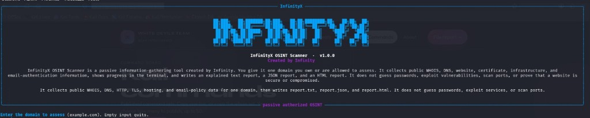

<div align="center">


<br>


<br><br>



<br><br>

**Point InfinityX at a domain you own or are allowed to assess.**  
It reads the public trail, shows the scan live, and writes a report a human can actually understand.

`report.txt` · `report.json` · `report.html`

</div>

---

<div align="center">

| | What you get |
|---|---|
| **01** | WHOIS, registrar, dates, nameservers, and status codes |
| **02** | DNS from two public resolvers, including mail and DNSSEC signals |
| **03** | The homepage: status, redirects, title, headers, robots, sitemap |
| **04** | The live certificate, hostname match, expiry, and transparency logs |
| **05** | Public IP, ASN, a cautious location estimate, and email policy |
| **06** | Correlation graph, scan history, diff exports, security audit, optional AI & Telegram |
| **07** | Passive subdomain intelligence (CT + optional DNS resolve) and local plugins |

</div>

InfinityX does not guess passwords, exploit services, or scan ports. A banner or a missing header is an observation, not proof of a vulnerability. The report never declares a site safe or compromised.

Type `y` to start a scan, or `n` to cancel. That question still appears when you pass `--domain`.

## Launch

Run this as a normal user, from the project folder. Do not use `sudo su`.

```bash
git clone https://github.com/Infinity-X202/infinityx-osint.git
cd infinityx-osint
chmod +x install.sh
./install.sh
source .venv/bin/activate
python main.py
```

If `install.sh` says `No such file or directory`, you are not inside `infinityx-osint`.

`install.sh` shows the package list and installs system packages only after you answer `y`.

```bash
python main.py
python main.py --domain example.com
python main.py --history
python main.py --compare 1 2
python main.py --telegram-test
python main.py --help
python main.py --domain example.com --enable-traceroute
```

### Interactive menu (`python main.py`)

| Key | Action |
|-----|--------|
| **1** | Start the full 50-check OSINT scan (`y` / `n` authorization) |
| **2** | Passive subdomain intelligence (crt.sh + optional A lookups) |
| **3** | Local scan history (`reports/infinityx.sqlite`) |
| **4** | Compare two scans → terminal view + `reports/comparisons/` export |
| **5** | Correlation summary from the latest stored scan |
| **6** | Security audit rows from the latest scan |
| **7** | Pointer to the AI section in the latest report |
| **8** | List recent report folders (`intel/correlation.json` inside each scan) |
| **9** | Telegram alert settings / test message |
| **10** | Enable or disable example plugins |
| **0** | Exit |

The first scan of a domain has nothing older to compare. The next scan writes **ADDED / REMOVED / CHANGED / UNCHANGED / UNKNOWN** diffs into the reports. History never re-runs checks for a comparison.

### Optional configuration

Copy `infinityx.env.example` to `infinityx.local.env` (git-ignored), export the variables, then run InfinityX.

- **Telegram:** `TELEGRAM_BOT_TOKEN`, `TELEGRAM_CHAT_ID`, `INFINITYX_TELEGRAM_ALERTS=1`
- **AI assistant:** `INFINITYX_AI_ENABLED=1`, `INFINITYX_AI_API_KEY`, `INFINITYX_AI_API_BASE` (OpenAI-compatible chat endpoint)
- **Graphviz:** install `graphviz` on Kali for `intel/correlation.png` (JSON and DOT always export)

## What lands on disk

Each scan creates `reports/<timestamp>_<domain>/`:

- `report.txt` — the full written analysis
- `report.json` — every check, for another tool to read
- `report.html` — cards, filters, and expandable evidence
- `raw_results/` — original public responses
- `logs/scan.log` — the run log, with secret-like values removed
- `intel/correlation.json` · `intel/correlation.dot` · optional `correlation.png`

## The fifty checks

Domain and WHOIS, DNS, the website, TLS, network identity, and email policy. Shared lookups are fetched once and labeled as the same evidence, not as a second discovery.

## Boundaries

Connections stay on public addresses. Redirects to localhost, private networks, link-local addresses, and metadata services are refused. DKIM selectors are not guessed. Traceroute stays off unless you pass `--enable-traceroute` and the command exists. Geolocation is an estimate and is often wrong for CDN and anycast addresses.

Optional Kali packages: `whois`, `traceroute`, `whatweb`. If one is missing, that check is `SKIPPED`.

## Tests

```bash
python -m unittest discover -s tests -v
```

<div align="center">


**Created by Infinity**

</div>
